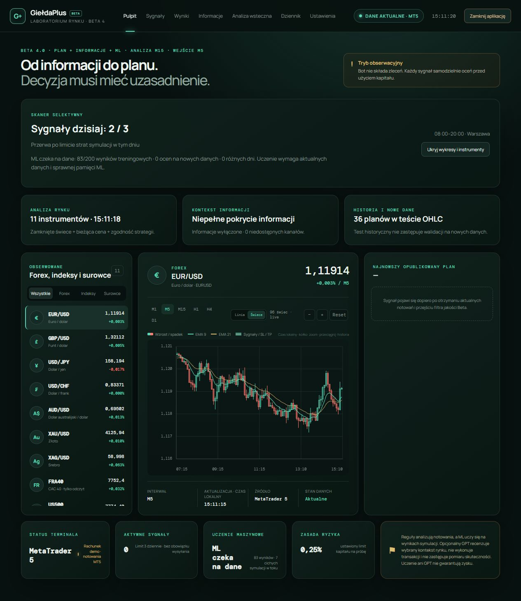
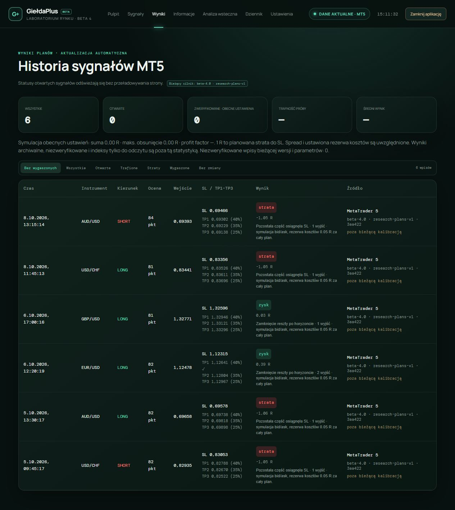
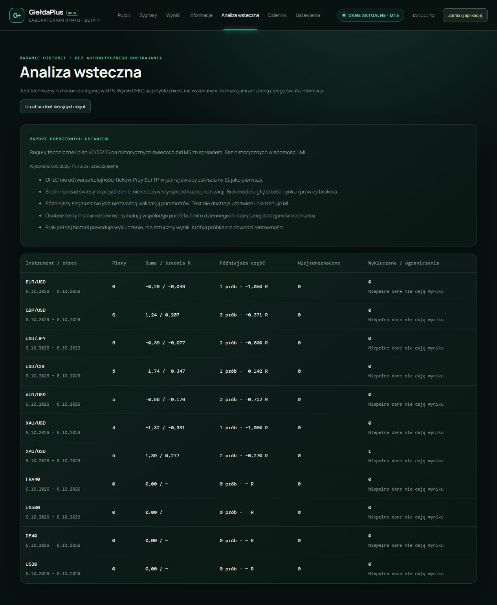

# GiełdaPlus

**A personal market research lab for Forex, indices, and commodities.**

GiełdaPlus is a local application I am building to bring market monitoring, technical analysis, news context, and strategy evaluation into one workspace. It connects to MetaTrader 5, creates structured trade simulations, and keeps a record of the reasoning and outcomes behind them.

**Status: Beta 4 · actively developed**  
**Source code: private · this repository is a project showcase**

## Why I am building it

I want to explore a question that goes beyond a simple LONG or SHORT label: **what conditions led to a decision, and what happened afterwards?**

The project combines a visual dashboard with an analytical engine that records entry conditions, simulated exits, and verified outcomes. My focus is on making the process explainable and testable, while being explicit about missing data and the limits of each method.

## Market dashboard

The dashboard brings together an instrument watchlist, interactive candlestick and line charts, multiple timeframes, moving averages, scanner status, and the current stage of local machine learning.

Market data comes from MetaTrader 5. The application checks quote freshness and distinguishes instruments available for analysis from those that are only available for observation.

## Analysis and simulated trade plans

The engine evaluates trend and momentum, pullbacks, range breakouts, Asian session breakouts, and mean reversion, with confirmations across timeframes. A candidate analysis remains separate from a published plan: a directional score alone does not trigger a signal.

Each published plan records:

- An entry price and a fixed stop loss.
- Three take-profit levels, with partial exits.
- The strategy, time horizon, and reasons behind the setup.
- The conditions that allowed or blocked publication.

The scanner also applies data-quality checks, spread and entry-distance constraints, session rules, and limits on published plans.

## Simulation history

The results view tracks published plans and their outcomes, including partial take-profit exits, stop losses, and time-based closure. Simulations use bid/ask prices and a configured cost reserve. State persists between sessions so that open plans can be reconciled after a restart.

The application distinguishes verified outcomes, expired or incomplete records, and results produced under earlier configurations. The screenshot below shows simulation records, including both gains and losses; it is not a live account statement.

## Historical testing

A dedicated backtesting view evaluates technical rules using available historical candles and spread data. Reports show results by instrument, later-period results, ambiguous cases, and excluded samples.

The test makes its assumptions visible. For example, when a candle contains both stop-loss and take-profit levels, it treats the stop loss as occurring first. Historical tests do not reproduce the full news context, local ML policy, or a shared portfolio.

## News context and machine learning

**News context:** public RSS/Atom publications are displayed with timestamps, sources, and links. The engine uses limited headline-based rules to identify possible market mechanisms and checks source coverage before publishing plans when that requirement is enabled.

**Local ML:** logistic and linear regression models learn from completed, verified tick-based simulations. The model must pass evaluation gates before it can influence candidate selection. Missing history is not treated as a training outcome.

**Optional GPT review:** selected market setups and news excerpts can receive an additional structured opinion through the OpenAI API. The integration includes configurable usage limits and an explicit consent setting. It does not execute trades or replace measured validation.

**Decision journal:** analysis cycles, blocking conditions, simulated exits, learning events, and source status are available in a dedicated diagnostic view.

## Technology stack

| Area | Technologies |
| --- | --- |
| Interface | HTML, CSS, JavaScript, Canvas charts |
| Application engine | Node.js and JavaScript modules |
| Market data bridge | Python and MetaTrader 5 integration |
| Machine learning | Local logistic and linear regression models |
| News ingestion | Public RSS/Atom feeds |
| Optional AI review | OpenAI API |
| Persistence | Local JSON files with atomic writes |

## Current focus

I am working on the reliability of the analytical engine, accurate simulation settlement, evaluation on new data, and clear explanations of why a candidate is accepted or rejected. Mobile access and running the engine beyond the local computer are possible future directions.

## About this showcase

The screenshots were captured from a separate local preview of the application, using market quotes without account identifiers and previously saved simulation reports. News fetching, automatic backtests, and paid GPT calls were disabled in that preview. The interface is currently in Polish; this project overview is in English.

GiełdaPlus operates in observation mode and **does not place orders**. Displayed outcomes are simulations, not real account returns. Scores are not probabilities of profit, and historical tests or AI opinions do not establish profitability.

This repository contains documentation and screenshots only. The application source code is private and is not distributed here.
